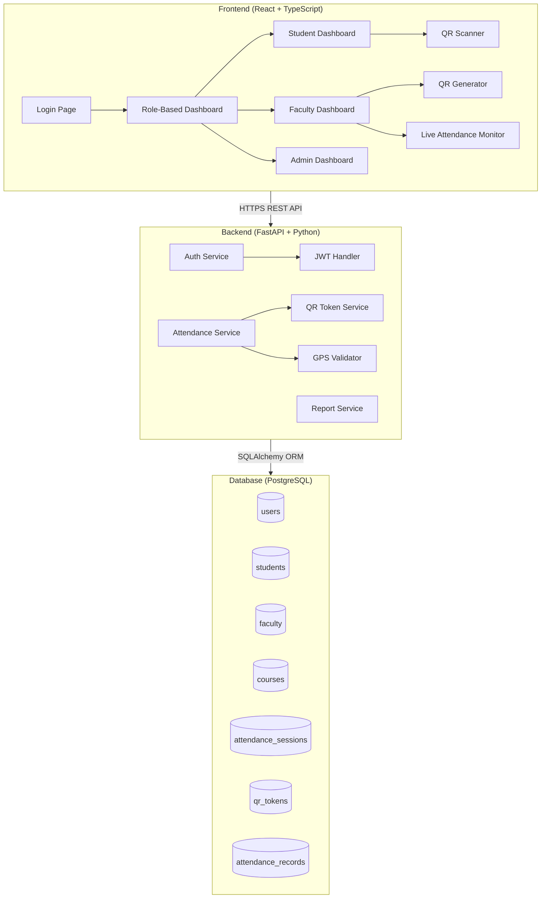

# SmartAttend 🎓

[](https://react.dev)
[](https://fastapi.tiangolo.com)
[](https://postgresql.org)
[](https://typescriptlang.org)
[](https://python.org)

**Smart QR-Based Attendance Management System** — A modern, secure, full-stack web application for managing attendance in colleges and universities using dynamic rotating QR codes.

> B.Tech CSE Final Year Project | Portfolio-Quality Software Engineering

---

## ✨ Features

- 🔐 **JWT Authentication** with refresh tokens & role-based access control
- 📱 **Dynamic QR Attendance** — cryptographically secure, auto-rotating QR codes
- 👥 **4 User Roles** — Super Admin, Admin, Faculty, Student
- 📊 **Analytics Dashboards** — real-time charts and attendance statistics
- 📍 **GPS Verification** — optional location-based attendance validation
- 📄 **Report Export** — CSV and PDF download
- 🌙 **Dark/Light Mode**
- 📱 **Fully Responsive** — works on mobile and desktop

---

## 🏗️ Architecture



---

## 🚀 Quick Start

### Prerequisites
- macOS (Apple Silicon M1/M2 compatible)
- Python 3.11+
- Node.js 20 LTS
- PostgreSQL 16

### 1. Clone & Setup
```bash
git clone https://github.com/yourusername/smartattend.git
cd smartattend
chmod +x scripts/setup.sh
./scripts/setup.sh
```

### 2. Configure Environment
```bash
cp backend/.env.example backend/.env
cp frontend/.env.example frontend/.env
# Edit the .env files with your DB credentials
```

### 3. Run Database Migrations
```bash
cd backend
source .venv/bin/activate
alembic upgrade head
python scripts/seed_data.py
```

### 4. Start Development Servers
```bash
# Terminal 1 — Backend
cd backend && source .venv/bin/activate && uvicorn main:app --reload

# Terminal 2 — Frontend
cd frontend && npm run dev
```

### 5. Access
- Frontend: http://localhost:5173
- API Docs: http://localhost:8000/api/docs
- Admin: http://localhost:5173/login

**Default test credentials:**
| Role | Email | Password |
|------|-------|----------|
| Super Admin | superadmin@smartattend.com | Admin@123 |
| Admin | admin@smartattend.com | Admin@123 |
| Faculty | faculty@smartattend.com | Faculty@123 |
| Student | student@smartattend.com | Student@123 |

---

## 📁 Project Structure

```
smartattend/
├── frontend/                    # React + TypeScript + Vite
│   ├── src/
│   │   ├── components/          # Reusable UI components
│   │   │   ├── ui/              # Base UI (Button, Input, Card, Table...)
│   │   │   ├── shared/          # Layout (Sidebar, Topbar, DashboardLayout)
│   │   │   └── attendance/      # QR display, scanner
│   │   ├── pages/               # Route pages per role
│   │   │   ├── auth/            # Login, ForgotPassword, Reset
│   │   │   ├── student/         # Student dashboard, QR scan, history
│   │   │   ├── faculty/         # Faculty dashboard, session management
│   │   │   ├── admin/           # Admin panel, reports, analytics
│   │   │   └── superadmin/      # System-wide management
│   │   ├── services/            # Axios API services
│   │   ├── hooks/               # Custom React hooks
│   │   ├── context/             # Auth & Theme contexts
│   │   ├── utils/               # Helpers, validators, constants
│   │   └── types/               # TypeScript interfaces
├── backend/                     # FastAPI + Python
│   ├── app/
│   │   ├── api/v1/endpoints/    # REST API route handlers
│   │   ├── core/                # Config, security, dependencies
│   │   ├── db/                  # Database session, base models
│   │   ├── models/              # SQLAlchemy ORM models
│   │   ├── schemas/             # Pydantic request/response schemas
│   │   ├── services/            # Business logic layer
│   │   └── utils/               # QR generator, GPS, PDF, CSV
│   ├── tests/                   # pytest test suite
│   ├── alembic/                 # Database migrations
│   └── main.py                  # FastAPI application entry
├── docs/                        # Complete documentation
├── scripts/                     # Setup and seed scripts
└── deployment/                  # Docker, nginx configs
```

---

## 📚 Documentation

| Document | Link |
|----------|------|
| Architecture | [docs/ARCHITECTURE.md](docs/ARCHITECTURE.md) |
| Database | [docs/DATABASE.md](docs/DATABASE.md) |
| API Reference | [docs/API_DOCUMENTATION.md](docs/API_DOCUMENTATION.md) |
| User Manual | [docs/USER_MANUAL.md](docs/USER_MANUAL.md) |
| SRS | [docs/SRS.md](docs/SRS.md) |
| Environment Setup | [docs/ENVIRONMENT_SETUP.md](docs/ENVIRONMENT_SETUP.md) |
| 30-Day Roadmap | [docs/30_DAY_ROADMAP.md](docs/30_DAY_ROADMAP.md) |
| Viva Q&A | [docs/VIVA_QA.md](docs/VIVA_QA.md) |

---

## 🔒 Security Features

- Passwords hashed with bcrypt (cost factor 12)
- JWT access tokens (30 min) + refresh tokens (7 days)
- QR tokens: cryptographically random, 30-second expiry, single-use tracking
- Role-based access control on every endpoint
- SQL injection prevention via SQLAlchemy ORM
- XSS prevention via React's default escaping
- CORS configured to whitelist only trusted origins
- Rate limiting on auth endpoints
- Server-side timestamps (never trust client time)
- Unique DB constraint prevents duplicate attendance

---

## 🧪 Testing

```bash
cd backend
source .venv/bin/activate
pytest tests/ -v --tb=short
```

---

## 📦 Deployment

See [docs/DEPLOYMENT.md](docs/DEPLOYMENT.md) for full deployment guide.

**Quick Docker Deploy:**
```bash
cp backend/.env.example backend/.env
# Edit .env
docker-compose -f deployment/docker/docker-compose.yml up -d
```

---

## 📄 License

MIT License — see [LICENSE](LICENSE)

---

**Built with ❤️ as a B.Tech CSE Final Year Project**
