# SmartAttend — System Architecture Document

## 1. High-Level System Architecture

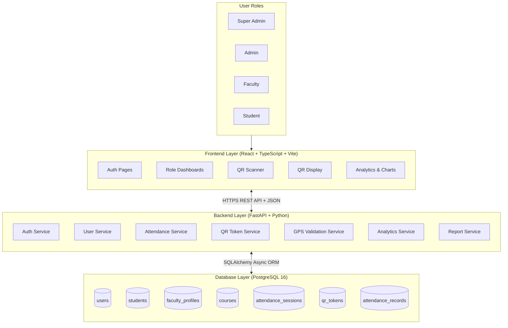

## 2. Frontend Architecture

The frontend follows a layered architecture:

**Layer 1 — Pages**: Route-level components mapped to URL paths, one per feature screen.
**Layer 2 — Components**: Reusable UI pieces (Button, Card, Table) and domain components (QRDisplay, AttendanceTable).
**Layer 3 — Hooks**: Custom React hooks encapsulate state logic (useAuth, useQRScanner, useGPS, usePagination).
**Layer 4 — Services**: Axios-based API clients, one file per backend domain.
**Layer 5 — Context**: Global state (AuthContext for user/tokens, ThemeContext for dark mode).
**Layer 6 — Utils**: Pure functions — format, validate, transform.

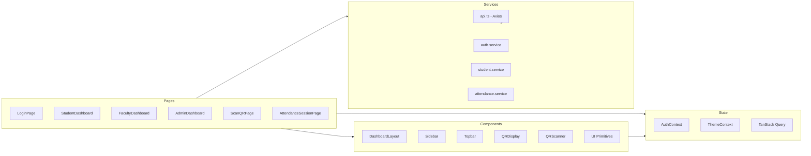

## 3. Backend Architecture

FastAPI follows a clean layered architecture:

**Layer 1 — API Routers** (`app/api/v1/endpoints/`): HTTP request/response handling, input validation, auth checks.
**Layer 2 — Services** (`app/services/`): Business logic, orchestration. No DB access in routers.
**Layer 3 — Models** (`app/models/`): SQLAlchemy ORM models representing DB tables.
**Layer 4 — Schemas** (`app/schemas/`): Pydantic models for request/response serialization.
**Layer 5 — Core** (`app/core/`): Config, security utilities, shared dependencies.

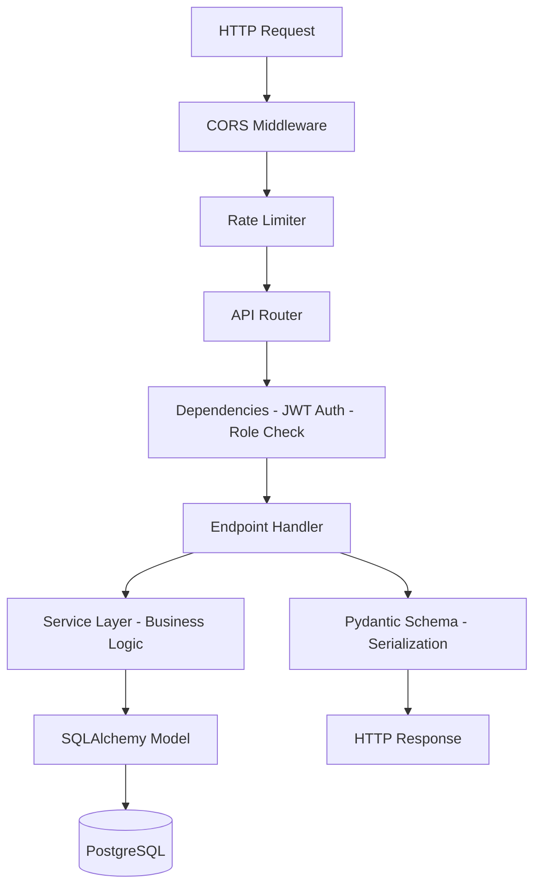

## 4. QR Token Lifecycle

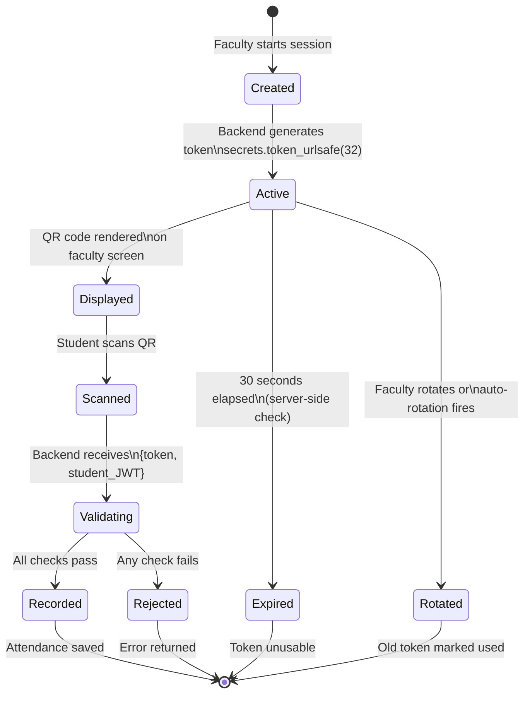

## 5. Attendance Workflow — Sequence Diagram

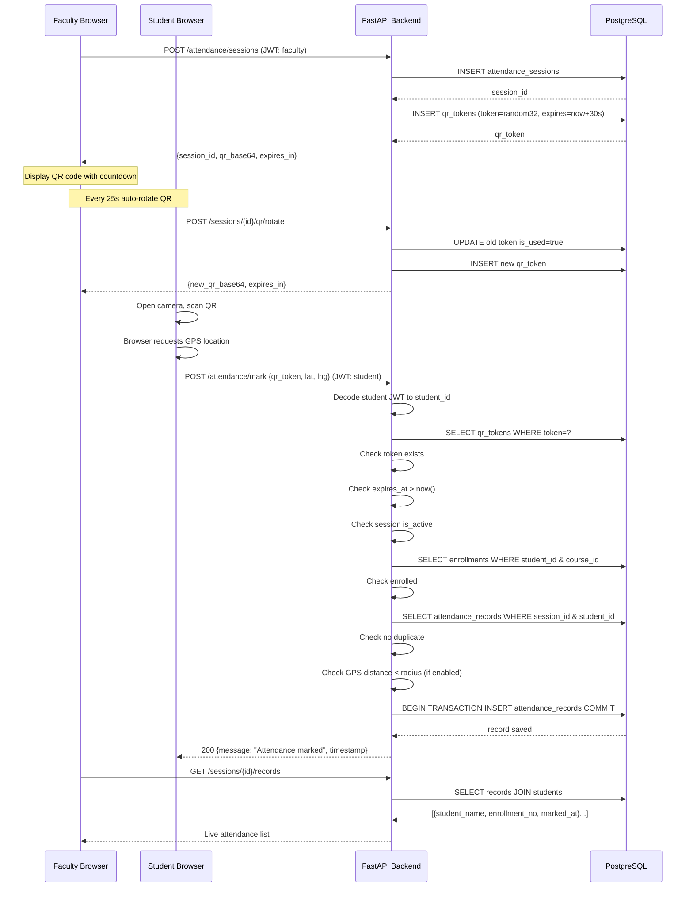

## 6. Authentication Architecture

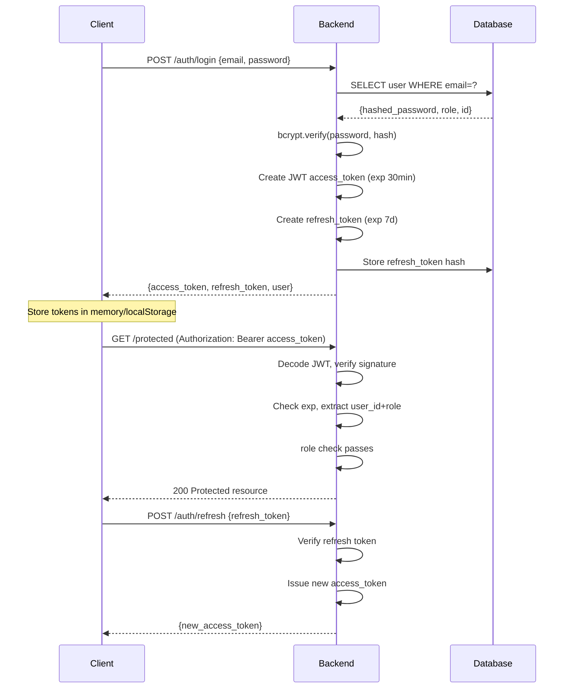

## 7. Database Architecture

The PostgreSQL database is designed in Third Normal Form (3NF):

**Core Entities**: users, students, faculty_profiles, departments, courses, academic_sessions
**Junction Tables**: enrollments, course_faculty_assignments, user_roles
**Attendance Tables**: attendance_sessions, qr_tokens, attendance_records
**Support Tables**: notifications, audit_logs, password_reset_tokens

## 8. ER Diagram

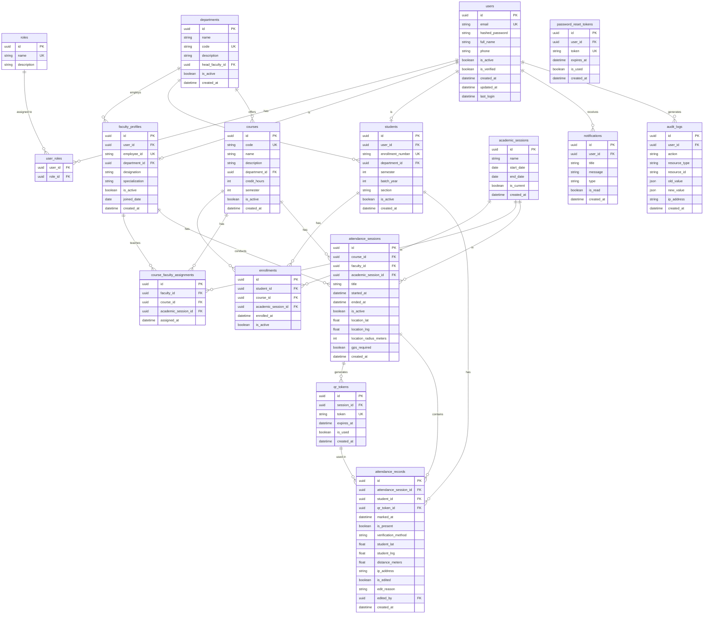

## 9. Security Architecture

### Threat Model & Mitigations

| Threat | Mitigation |
|--------|-----------|
| Password theft | bcrypt hashing, cost factor 12 |
| Token theft | Short-lived access tokens (30min), HTTPS only |
| QR replay attack | Server checks is_used flag + expiry |
| QR token prediction | cryptographically random (secrets.token_urlsafe) |
| Fake student ID | Student ID always from JWT, never from request body |
| Duplicate attendance | UNIQUE(session_id, student_id) DB constraint + pre-check |
| SQL injection | SQLAlchemy ORM parameterized queries |
| XSS | React escapes all rendered content by default |
| CSRF | JWT in Authorization header (not cookies) |
| Brute force | SlowAPI rate limiting on /auth endpoints |
| Unauthorized access | Role checks on every protected endpoint |
| GPS spoofing | Acknowledged limitation; documented as advisory |

## 10. Deployment Architecture

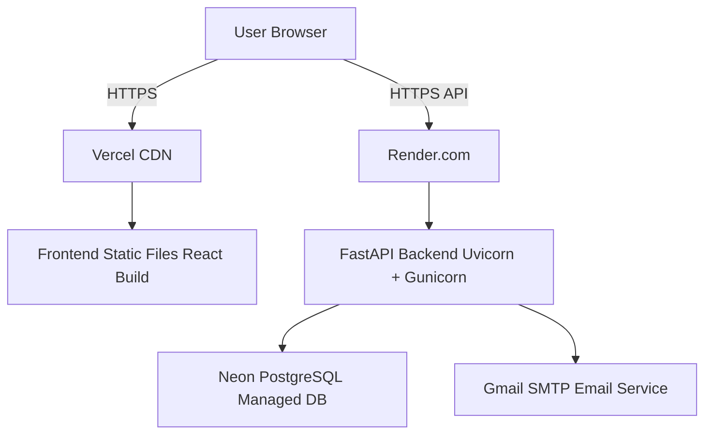

## 11. DFD Level 0 — Context Diagram

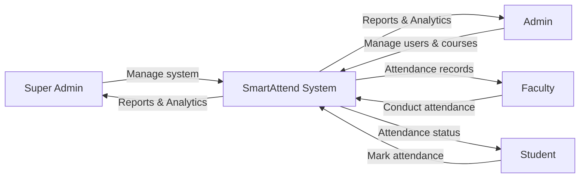

## 12. DFD Level 1

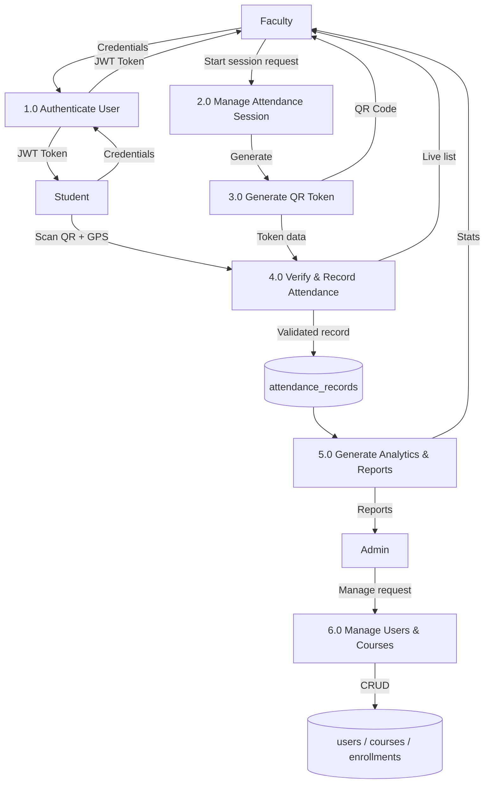

## 13. Use-Case Overview

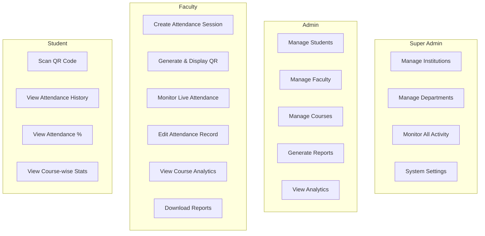
