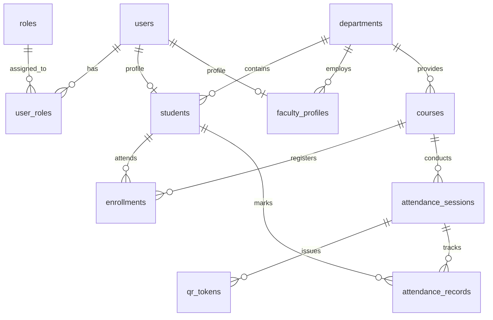

# SmartAttend — Database Specification & Schema Design

## 1. Relational Database Overview (3NF)
SmartAttend is architected on PostgreSQL 16 utilizing normalized relational entities to guarantee zero data anomalies, ACID transaction compliance, and high throughput.

### Entity Relationship Model

## 2. Table Catalog
1. **users**: Primary authentication identities.
2. **roles**: Role definition (`super_admin`, `admin`, `faculty`, `student`).
3. **user_roles**: Junction table mapping users to roles.
4. **departments**: Academic departments (e.g., CSE, ECE, ME).
5. **faculty_profiles**: Professional credentials and department affiliation.
6. **students**: Academic record, enrollment number, semester, section.
7. **courses**: Syllabus modules linked to departments.
8. **academic_sessions**: Semester timeline management.
9. **enrollments**: Course registration junction with unique constraint `(student_id, course_id, academic_session_id)`.
10. **attendance_sessions**: Class attendance windows with optional GPS bounding.
11. **qr_tokens**: Rotating cryptographic dynamic tokens with 30-second TTL.
12. **attendance_records**: Immutable verification events guarded by composite unique constraint `(attendance_session_id, student_id)`.
13. **audit_logs**: Change audit trail storing before/after values as JSONB.

## 3. Indexing Strategy
- `users(email)`: Unique B-tree index for O(1) login resolution.
- `students(enrollment_number)`: Unique index for student lookup.
- `qr_tokens(token)`: Unique hash-distributed B-tree index.
- `attendance_records(attendance_session_id, student_id)`: Composite unique index preventing duplicate verification.
